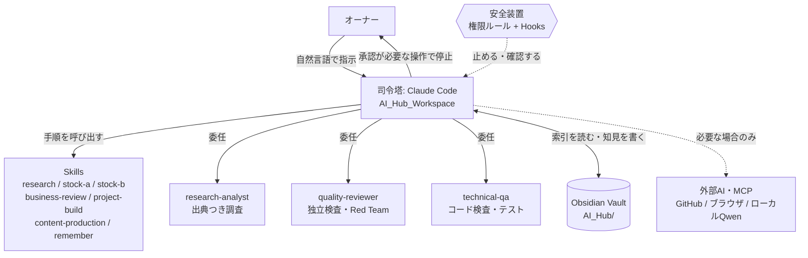
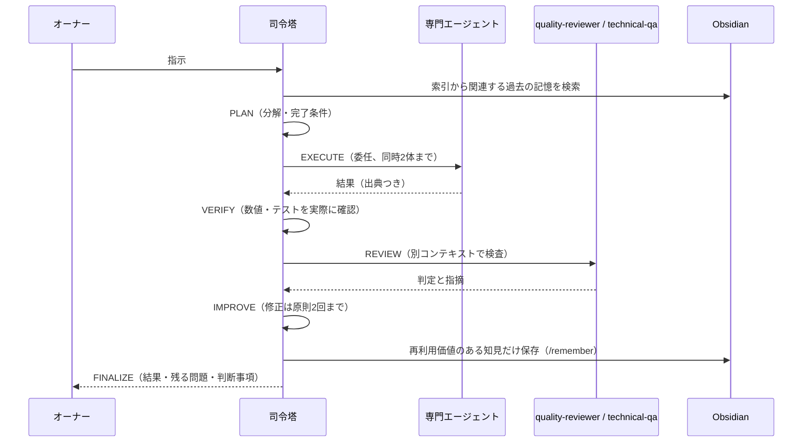

# SYSTEM_ARCHITECTURE — 個人用AIエコシステムの構成

## 全体像

## 1つの依頼が流れる順番

## 構成要素と置き場所

| 要素 | 場所 | 役割 |
|---|---|---|
| 司令塔フォルダ | `%USERPROFILE%\AI_Hub_Workspace` | Claude Code をここで起動する |
| 基本方針 | `CLAUDE.md` | 毎回必要な方針だけ（63行） |
| 設定 | `.claude/settings.json` | 権限ルール・Hooks・環境変数 |
| Vault の場所 | `.claude/ai-hub.json` | Hooks と Skills が読む |
| Skills | `.claude/skills/<name>/SKILL.md` | 定型業務の手順（7本） |
| 専門エージェント | `.claude/agents/*.md` | 別コンテキストで動く担当（3体） |
| Hooks | `.claude/hooks/*.ps1` | 記憶の読み込み・秘密情報の防止・レビューの強制 |
| 長期記憶 | `<Vault>\AI_Hub\` | 決定・知見・進捗・調査結果 |

**ユーザー全体の設定（`~/.claude`）には触れません。** すべて司令塔フォルダの中に閉じています。
他のプロジェクト（THEMORA など）でも Skills を使いたくなったら、動作を確認したうえで `~/.claude/skills/` に移します（[ロードマップ](#拡張のロードマップ)）。

## 記憶の設計

| 層 | 中身 | 読み込まれ方 |
|---|---|---|
| 索引 | `00_Home/AI_HOME.md`・`PROJECT_INDEX.md`・`MEMORY_INDEX.md` | セッション開始時に自動（合計6,000文字まで） |
| 本文 | 各ノート | 必要なときだけ司令塔が検索して読む |
| 保存 | `/remember` | 分類 → 重複確認 → 1ノート1話題 → 索引に1行 |

- **毎回すべてを読み込まない。** 索引だけを渡し、本文は検索で取る。Claude Code の SessionStart の上限（10,000文字）に対して余裕を持たせている
- **会話を丸ごと保存しない。** 再利用価値のあるものだけを `/remember` で保存する
- **決定の変更は履歴を残す。** 古いノートは消さずに `status: superseded`
- **Claude Code の自動メモリ（auto memory）は司令塔フォルダでは無効。** 記憶を Obsidian と二重に持たないため

## 品質管理

「自分の成果物を自分で確認して」では不十分なので、検査は別コンテキストで行います。

| 仕組み | 内容 |
|---|---|
| `quality-reviewer` | 文章・調査・投資分析・事業案を検査。作成者に同意しないことが仕事。編集権限なし |
| `technical-qa` | コードを検査しテストを実行。**修正権限を外してある**ので、実装と検査が分離される |
| レビュー強制（Hooks） | ファイルを変更したのに独立レビューを経ずに終わろうとすると、1回だけ止めて促す |
| ループ防止 | 止めるのは1回だけ。Claude Code の `stop_hook_active` も見ている。修正は原則2回まで |

動画で紹介されていた判断専用AI「Jev（TypeSafe Jev）」は、一般に利用できる製品として確認できなかったため、上の組み合わせで代替しています。

## 安全装置（文章の約束に頼らない）

| 層 | 止めるもの | 方式 |
|---|---|---|
| 拒否（deny） | `.env`・秘密鍵の読み書き、`git push --force`、`--dangerously-skip-permissions` | 権限ルール |
| 確認（ask） | 削除、`git push`、`git reset --hard`、デプロイ、公開、グローバルインストール、モデルのダウンロード、MCP 追加、`~/.claude` の変更 | 権限ルール |
| 無効化 | bypassPermissions モード | `disableBypassPermissionsMode: "disable"` |
| 内容の検査 | APIキー・秘密鍵のファイルへの直書き | PreToolUse Hook |
| 同時稼働 | エージェントは2体まで | `CLAUDE_CODE_MAX_CONCURRENT_SUBAGENTS=2` |

権限ルールは Bash と PowerShell の両方に書いています。Windows では Git Bash がないと PowerShell ツールが使われるためです。

## AI の役割分担と導入判断

| 候補 | 判断 | 理由 |
|---|---|---|
| Claude Code（Pro の OAuth 認証） | **採用（司令塔）** | 既存契約の範囲で動く。API キーは設定しない |
| 専門エージェント3体 | **採用** | 追加費用なし（Pro の利用枠を使う） |
| Obsidian（通常のファイルアクセス） | **採用** | 専用 MCP は不要。ファイルとして読み書きできる |
| ローカル Qwen（Ollama） | **PHASE 0 の結果次第** | 導入済みなら軽い分類・整形に限って使う。新しいモデルは勝手に入れない（VRAM 6GB） |
| Codex CLI | **保留** | 独立したコードレビュー役として有望。料金と認証条件を確認してから |
| Antigravity / Gemini CLI | **保留** | 長文レビュー・Google Workspace 向け。料金と提供条件を確認してから |
| Google Workspace MCP | **保留** | 実際に使う業務が決まってから。提供条件（Developer Preview の要件等）を確認する |
| GitHub | **PHASE 0 の結果次第** | `gh` が導入・認証済みならそれを使う。MCP は必須ではない |
| ブラウザ操作（Playwright 等） | **必要になったとき** | 字幕取得・Web 確認で必要になったら検討 |
| Gmail / Slack / Money Forward / Figma / Remotion / Vercel / Cloudflare | **今回は導入しない** | 送信・公開・会計に関わり、承認フローを先に固める必要がある |

## 想定される追加費用

**0円。** 新しい契約・API 従量課金は発生しません。
注意点として、専門エージェントとレビューは Claude Pro の利用枠を消費します。重い作業を続けると利用上限に早く達するので、簡単な作業にはエージェントを使わない方針にしています。

## 拡張のロードマップ

1. 司令塔フォルダで安定運用を確認する
2. よく使う Skills を `~/.claude/skills/` に移し、THEMORA などのプロジェクトからも使えるようにする
3. Codex / Gemini を、料金を確認したうえで「別モデルによる独立レビュー」として追加する
4. Remote Control（Pro で利用可）でスマートフォンから操作する
5. 定期的な調査（決算カレンダーの確認など）を Claude Code のスケジュール機能で自動化する
6. 失敗の記録（`type: failure`）がたまったら、Skills の手順に反映して同じ失敗を防ぐ
